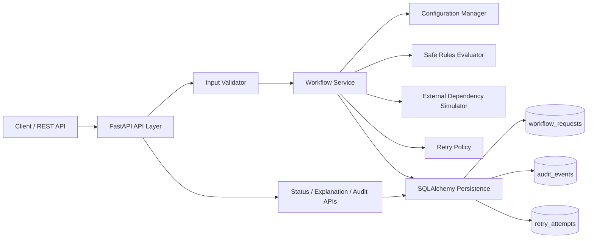
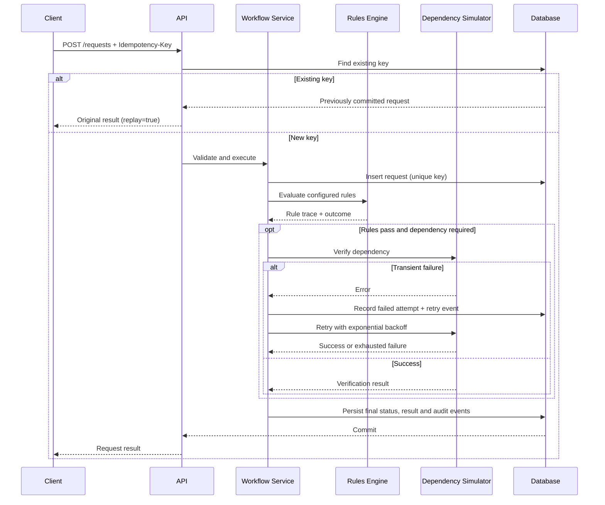
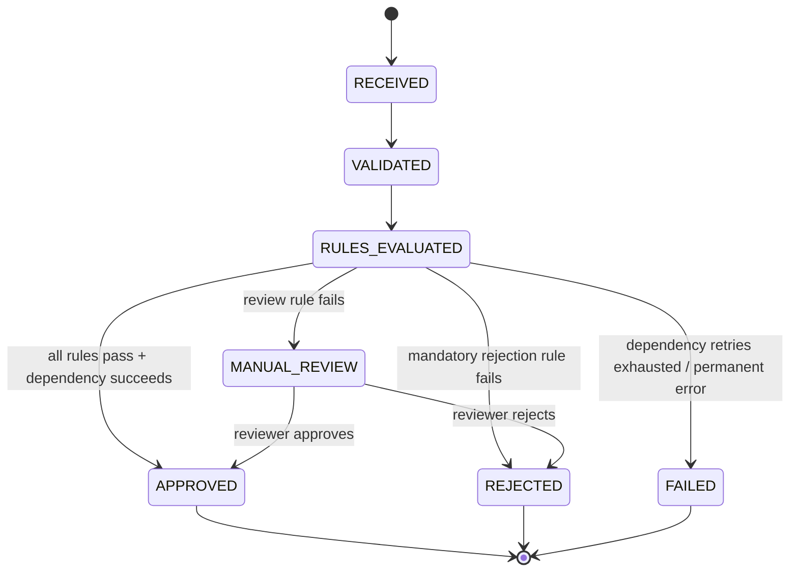
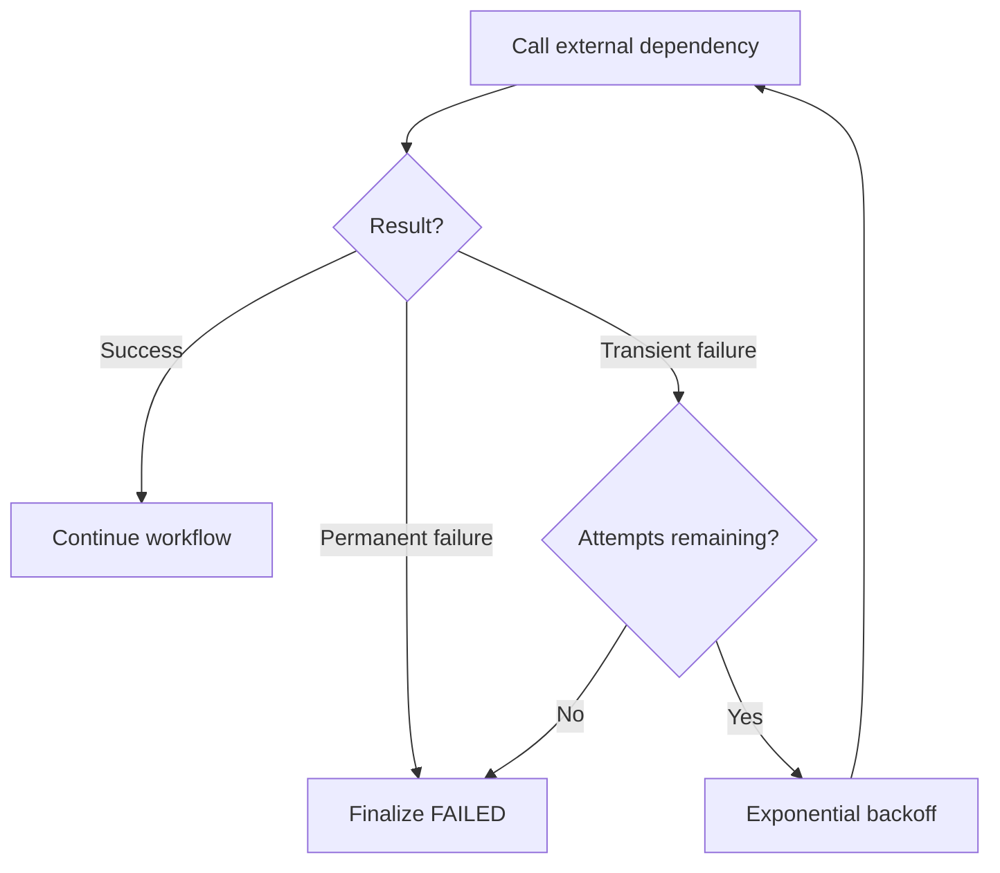

# Architecture — Resilient Decision System

## 1. Problem understanding and boundaries

The platform accepts a structured business request, validates it against a workflow-specific input contract, evaluates a versioned set of business rules, optionally calls an external dependency, chooses an outcome, persists the result, and exposes a traceable explanation. A manual-review outcome can be resolved by a reviewer through the API, producing a final decision and additional audit events. The engine is generic; loan and insurance policies live in JSON configuration.

**In scope:** request validation, deterministic rule evaluation including composite `all`/`any` conditions, workflow outcome selection, request state, idempotency, dependency simulation, bounded retries, persistence, audit retrieval, configuration registration and version history, manual-review resolution, and tests.

**Out of scope:** real credit/document provider integrations, reviewer assignment/queues and SLA management, distributed orchestration, and authentication/tenant management.

## 2. High-level architecture

### Component responsibilities

| Component | Responsibility |
|---|---|
| API layer (`app/main.py`) | HTTP contracts, headers, status codes, dependency injection, error mapping |
| Configuration manager | Loads and validates workflow JSON; atomically registers a new version and archives the previous one |
| Input validator | Enforces required fields and configured primitive types |
| Rules evaluator (`app/rules.py`) | Applies allow-listed operators and composite `all`/`any` groups in priority order; returns pass/fail/skipped trace |
| Workflow service | Coordinates lifecycle, rules, dependency calls, transitions, result and audit creation, and manual-review resolution |
| Dependency simulator | Simulates success, transient timeout/outage, and permanent failure |
| Retry policy | Bounded exponential backoff for transient errors only |
| Persistence | SQLAlchemy models and transaction boundary for request, audit, and retry rows |

## 3. Request processing sequence

When the outcome is `MANUAL_REVIEW`, the request is persisted without calling the external dependency. A reviewer later calls `POST /requests/{id}/review`; the service validates that the request is still awaiting review, records the reviewer decision and transition, and commits the updated result while preserving the original rule trace.

## 4. State machine

## 5. Rule evaluation and configurability

A rule is a data record with a field path, operator, expected value, priority, failure outcome, and explanation. A rule may instead declare a composite condition group with `match: "all"` or `match: "any"` and a list of field/operator/value conditions; each sub-condition is recorded individually in the trace. Rules are sorted by ascending priority. The first terminal failure determines the decision; later rules are recorded as `SKIPPED`, making short-circuit behavior explicit. The evaluator does not use `eval`, dynamic imports, or arbitrary executable configuration.

Loan approval and insurance claim processing use the same service and evaluator. Their different required fields, thresholds, composite conditions, failure outcomes, and dependencies are configuration-only. A threshold update plus version increment changes decisions without changing engine code. The insurance workflow demonstrates a composite `all` rule that routes recent or high-value claims to manual review.

## 6. Idempotency and consistency

The client supplies `Idempotency-Key`. The key has a unique database constraint, and the request row is inserted before processing inside the same transaction. A repeated committed key with the same workflow and payload returns the original result. Reusing a key with a different workflow, payload, or simulation mode is rejected with `409 Conflict` instead of silently returning an unrelated result. The unique constraint is the final arbiter if two requests race; the normal sequential replay path is covered by tests.

Request, audit, and retry rows are committed together. If application processing fails before commit, the transaction is rolled back, preventing a persisted half-finalized request. This design does not claim distributed exactly-once processing. For production external calls, use the idempotency key as a downstream request key where supported, plus an outbox, durable workers, and reconciliation for crash windows.

## 7. Retry and failure handling

Only dependency exceptions marked transient are retried. The delay is `base_delay_seconds × 2^(attempt - 1)`, and attempts are bounded by the workflow's `max_attempts`. Validation and business-rule failures do not invoke the dependency. Permanent dependency failures are not retried. Every attempt and retry scheduling decision is audited.

## 8. Persistence schema

- `workflow_requests`: primary key request UUID; unique idempotency key; workflow name/version; status; original JSON input; final JSON result; timestamps.
- `audit_events`: append-only integer ID; request ID; event type; JSON details; timestamp.
- `retry_attempts`: append-only integer ID; request ID; attempt number; outcome; error; timestamp.
- `configs/history/*.json`: immutable archived workflow definitions written when a new version is registered.

The current implementation indexes request status, workflow name, idempotency key, and request IDs in event/attempt tables. Foreign-key declarations and retention/partitioning policies can be added as the deployment database is hardened.

## 9. API design

The FastAPI OpenAPI schema is available at `/docs`. `POST /requests` requires `Idempotency-Key`. Missing/invalid body fields return 422; unknown workflow/request/version returns 404; reusing an idempotency key with a different workflow or payload returns 409. `POST /requests/{id}/review` resolves a `MANUAL_REVIEW` request and returns 409 if the request is not awaiting review or has already been resolved. The status, explanation, audit, and workflow-version endpoints are read-only. Configuration registration validates the submitted JSON before writing it, archives the previous version, and rejects duplicate or decreasing versions.

## 10. Scaling considerations

1. Replace SQLite with PostgreSQL and use connection pooling, migrations, and transaction isolation appropriate to the workload.
2. Move execution to a durable queue (e.g., RabbitMQ, SQS, Kafka) for long-running or high-volume workflows; return 202 and expose status polling/webhooks.
3. Partition or archive audit data by time/workflow; index request ID and event timestamp.
4. Cache immutable workflow versions and pin each request to the exact version it started with.
5. Apply per-dependency timeouts, circuit breakers, bulkheads, rate limits, and bounded queues.
6. Add metrics for decision latency, rule outcomes, retry rate, dependency availability, queue depth, and terminal state counts.
7. Use optimistic locking/version columns if multiple operators can update a request concurrently.

## 11. Security considerations

Validate all client input and configuration; keep the rule language allow-listed; never execute uploaded code; keep secrets in environment/secret management; restrict configuration mutation to authorized operators; add authentication, role-based authorization, tenant scoping, rate limits, request-size limits, PII redaction, encryption at rest/in transit, and audit access controls before production deployment. The demo intentionally has no authentication layer.

## 12. Trade-offs and assumptions

- **FastAPI + Pydantic:** quick typed REST interface and schema validation suited to a time-boxed hackathon.
- **JSON configuration:** human-readable and versionable; a constrained operator DSL is safer than embedding scripts.
- **SQLite:** zero-service local setup and transactional consistency; not intended for multi-node production.
- **Synchronous execution:** easy to demonstrate end-to-end behavior; queue-based execution is the next step for long-running workflows.
- **Manual review resolution:** a review can be approved or rejected through `POST /requests/{id}/review`, with reviewer identity and notes stored in the result and audit log. Reviewer assignment, queues, and SLA tracking are intentionally left out of scope.
- **Simulated dependency:** deterministic failure modes make retry behavior reproducible in tests; a real integration needs timeout budgets and downstream idempotency.

## 13. Future improvements

Add formal schema validation per workflow (JSON Schema), nested field paths, explicit conditional transitions between arbitrary stages, reviewer assignment/queues, configuration approval/rollback, database migrations, role-based access control, background workers, outbox/inbox processing, metrics/tracing, and chaos/concurrency tests against PostgreSQL.
